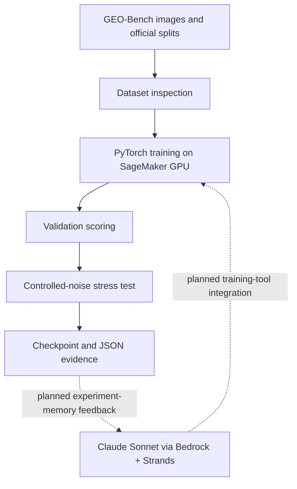

# GeoGuardian-AI
# GeoGuardian
### Training geospatial AI models is only half the problem. Understanding when they fail matters too.

**GeoGuardian** is my prototype for the **AUB ACM × RASID GoTrain Hackathon (2026)**. I built it to explore a simple question: *Can automated geospatial model development consider reliability alongside accuracy?*

The long-term vision is a bounded AI engineering agent that inspects GEO-Bench datasets, trains and compares models, records evidence from experiments, and checks how predictions change under controlled image disturbances. My current working prototype is a real **13-channel EuroSAT land-cover classifier** trained with PyTorch on the RASID-provided SageMaker environment, plus a validation-based noise stress test. I also connected **Claude Sonnet through Amazon Bedrock and Strands**, and tested an initial tool call. **The LLM does not yet autonomously run my training pipeline.**

## Why I built it

Satellite imagery can support land-use analysis, environmental monitoring, and other decisions. A model's accuracy on clean benchmark data tells part of the story, but it doesn't tell us how consistently the model behaves when the input changes. My cybersecurity background pushed me to ask not only whether a model works, but **how it fails, how we measure that failure, and how we document it**.

GeoGuardian is an experiment in bringing that defensive mindset to geospatial machine learning.

## Verified prototype results

All numbers below are **validation-set results for the `m-eurosat` classification task**, not final test-set results. They were obtained in the hackathon SageMaker environment and reported from executed notebook outputs.

| Measurement | Result |
| --- | ---: |
| Training examples | 2,000 |
| Validation examples | 1,000 |
| Input | 13 spectral bands, 64 × 64 pixels |
| Model | Small custom PyTorch CNN |
| Initial validation accuracy (epoch 1) | 31.0% |
| Epoch 2 | 45.0% |
| Epoch 3 | 43.2% |
| Epoch 4 | 50.1% |
| Latest measured clean validation accuracy | **55.7%** |
| Mild-noise validation accuracy | 55.9% |
| Stronger-noise validation accuracy | 52.2% |
| Drop from clean to stronger noise | **3.5 percentage points** |

The latest 55.7% came from a subsequently saved checkpoint. Detailed intervening epoch results were not supplied here, so I have not invented that training history. Mild noise scoring 0.2 points above clean is a small variation, not evidence that noise improves the model.

**Interpretation:** The checkpoint was relatively insensitive to the specific mild perturbation tested, but accuracy declined under the stronger perturbation. These preliminary checks **do not establish adversarial security, real-world robustness, or deployment readiness**. The classifier still makes substantial errors.

## What works today

- Connected Claude Sonnet to a Strands agent using Amazon Bedrock in the organizer-provided SageMaker environment.
- Demonstrated a simple Strands Python tool call using predefined dataset metadata.
- Loaded GEO-Bench `m-eurosat` with the official training and validation splits.
- Trained a 13-channel PyTorch CNN using a CUDA GPU and saved model checkpoints.
- Measured classification validation accuracy and tracked improvements across training epochs.
- Evaluated the saved model on clean, mildly perturbed, and more strongly perturbed validation images.
- Saved JSON results and calculated per-class accuracy in the extended diagnostic run.

## Planned, not yet implemented

- A Strands agent that **actually invokes** training and validation tools autonomously.
- Append-only experiment memory with deduplication, error handling, and bounded search.
- Systematic model selection across accuracy, robustness, and runtime.
- Support for the other three required GEO-Bench tasks (one more classification and two segmentation tasks).
- Single final test-split evaluation after model selection is frozen.

This project is a **partial hackathon prototype**, not a completed solution to the full four-task GoTrain brief.

## How the system fits together



**Why the boundaries matter:** Python code should enforce data splits, permitted configurations, metrics, and saved artifacts. Claude should help select experiments and explain observed results, not invent scores or freely alter the evaluation rules.

## Repository contents

```text
GeoGuardian/
├── README.md
├── requirements.txt
├── .gitignore
├── notebooks/
│   └── README.md              # Where to put downloaded SageMaker notebooks
├── results/
│   ├── training_history.csv
│   ├── robustness_results.csv
│   └── README.md              # Where to put the actual JSON reports
├── models/
│   └── README.md              # Local model files (not committed by default)
└── docs/
    ├── MODEL_CARD.md
    └── DEMO_AND_NEXT_STEPS.md
```

**Please add your real notebooks** (`GeoGuardian_Model_Training.ipynb`, `GeoGuardian_Security_Analysis.ipynb`, plus `GoTrain_Agent.ipynb` if separate) after downloading them from JupyterLab. They have not been supplied to this packaging environment, so this archive does not pretend to include them. The CSVs transcribe results reported from the live notebook; they are not substitutes for executable code or native logs.

## Reproducing the prototype

1. Use a Python environment with PyTorch, GEO-Bench, NumPy, h5py, and Jupyter. The exact packages from the SageMaker session should be recorded before claiming full reproducibility.
2. Obtain `m-eurosat` from the official GEO-Bench distribution; retain the **official train/validation/test partitions**.
3. Open the notebook(s) downloaded from SageMaker. Review each cell and run in order against your locally configured dataset path.
4. Do not evaluate on the test split while tuning.
5. Read generated validation and robustness reports alongside the saved checkpoint.

The model used all 13 bands in their existing stored order. GEO-Bench v1.0 warns that `m-eurosat` has incorrect **band-name metadata** for many channels; selecting bands by displayed name can inadvertently select the wrong channel. The pixel data itself is unaffected. Our simple input pipeline clipped raw values to `[0, 10000]` and scaled to `[0, 1]`; this is a baseline preprocessing decision, not an optimized sensor-specific normalization procedure.

## Responsible evaluation and security

- **No test leakage:** use validation for experiment selection; reserve test for the final frozen model.
- **Evidence over claims:** only report scores produced by actual evaluation code.
- **Input checking:** verify shapes, channel counts, and label ranges before training.
- **Model reliability:** controlled Gaussian noise is a diagnostic, not a security certification.
- **Agent permissions:** future automation should use constrained, typed Python tools and avoid arbitrary command execution.
- **Credentials:** never commit SageMaker authorization URLs, access keys, notebooks containing secrets, or raw private datasets.

## Roadmap

**Next engineering milestone:** wrap a working `train` and `validate` routine as Strands tools; let the agent propose one of a few vetted configurations, launch an experiment, read its measured validation score, and record the outcome.

**Then:** complete the required second classification and two segmentation tasks, introduce a bounded experiment ledger, add reliable per-task metrics, freeze model selection, and conduct the one-time final test evaluation.

## A note on the challenge

This is my independent prototype in response to RASID's **GoTrain** brief. Its wider goal is to train geospatial models autonomously across two classification and two segmentation GEO-Bench tasks. GeoGuardian's reliability-aware reporting is my proposed additional direction; it is **not a claim that RASID formally endorsed the project, that the full challenge is complete, or that it won an award**.

---

**Built by a second-year Computer Science student at the American University of Beirut.** Interested in backend development, cybersecurity, AI agents, and the overlap between machine-learning performance and system trustworthiness.
